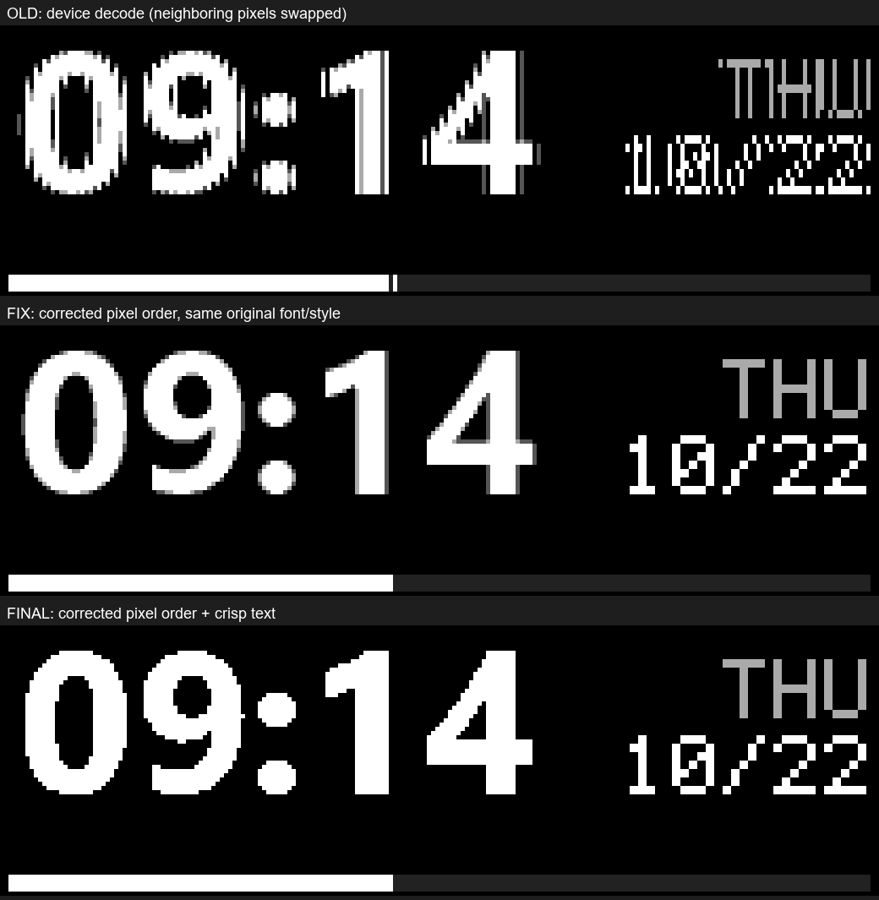

# 夜魔 X OLED 字体清晰化修复教程

日期：2026-10-22。适用项目：`AzothX-OLED`。文中的 `E:\AzothX-OLED` 是本次工作目录；克隆到其他位置时，请替换为实际路径。

**这次显示变清楚的关键，是纠正了相邻两个像素的存储顺序。** 原来的程序把左、右像素写反了，文字笔画因此出现梳齿和断裂。修正顺序后，再把默认文字改成硬边显示，得到当前效果。

当前项目已经完成修复，并已上传到键盘。用户查看大数字和右侧日期后确认：“已经清楚了”。下面记录完整原理和复现方法，方便以后维护或排查类似问题。

## 1. 屏幕上的字是怎样生成的

这个项目先把时间、日期等内容画成一张图片，再把图片编码成屏幕需要的字节，最后上传给键盘。


本机使用 **208×64 的绘图区**。每个像素用 4 个二进制位表示亮度，因此有 16 个亮度等级，范围是 0～15。这个格式叫 **4bpp**，意思是“每个像素占 4 位”。

一个字节有 8 位，恰好容纳两个像素。问题就出在：这两个像素应该按什么顺序放进去。

## 2. 为什么之前换字体仍然不清楚

此前主要调整了字体、字号和边缘灰度，也把日期改成了点阵字。点阵字是用固定的小方格组成的文字，不依赖曲线缩放。

这些方法可以改变文字外观，但文字画好后，仍然要经过像素编码。如果编码顺序错误，正确的笔画也会被打乱。

旧程序最终造成的效果是：

```text
原来一行：A B C D E F G H
屏幕一行：B A D C F E H G
```

每一对相邻像素都交换了位置。斜线和圆弧因此出现细小梳齿，小字容易变成难以辨认的碎块。整块颜色相同的区域变化较小，所以不能仅凭大白块显示正常就认定像素格式正确。

这也解释了一个排查线索：**电脑上保存的 PNG 可以很清楚，键盘上却仍然发糊。** PNG 预览通常位于编码之前，不能反映编码后发生的错误。

## 3. 如何确定正确顺序

这次重新核对了项目内保存的原厂反编译代码，没有直接沿用旧交接文档中的结论。

证据文件：`decompiled/GearLink_KBAgent.decompiled.cs`（本地分析材料，不随仓库分发；协议摘要见 [通信与像素格式](docs/PROTOCOL.md)）。

首先，第 523～525 行按当前列、下一列的顺序读取两个像素，再传入 `MergePixel`。因此，第一个参数是左像素，第二个参数是右像素。

接着，第 776～797 行把两个亮度分别除以 16，变成 0～15 的值。函数最后这样拼接二进制字符串：

```csharp
string text = IntToBits(num);
return Convert.ToInt32(IntToBits(num2) + text, 2);
```

其中，`num` 来自左像素，`num2` 来自右像素。`IntToBits` 会把每个数补齐为 4 位二进制字符串。

二进制字符串左侧是高位，所以正确布局是：

```text
一个字节： [高 4 位：右像素] [低 4 位：左像素]
```

“半字节”就是这 4 个位。原来的实现和交接文档把高、低半字节的含义写反了。

以“左白、右黑”为例：白色量化后是 15，即二进制 `1111`；黑色是 0，即 `0000`。

| 项目 | 一个字节的内容 | 设备显示结果 |
|---|---|---|
| 正确编码 | `0000 1111`，即 `0x0F` | 左白、右黑 |
| 旧版错误编码 | `1111 0000`，即 `0xF0` | 左黑、右白 |

这里的 `0x` 表示十六进制。高低半字节顺序是本机所用格式的约定，不能直接推广到所有 OLED 屏幕。

## 4. 代码具体改了哪里

### 4.1 根本修复：纠正像素编码

文件：[tools/oled.py](tools/oled.py)，函数 `render_4bpp`。

旧代码把左像素放进高 4 位：

```python
# 旧版：错误
out[i] = (px[x, y] & 0xF0) | ((px[x + 1, y] & 0xF0) >> 4)
```

修复后，右像素放进高 4 位，左像素放进低 4 位：

```python
# 当前版本：正确
out[i] = (px[x + 1, y] & 0xF0) | ((px[x, y] & 0xF0) >> 4)
```

用更容易阅读的写法表达，等价于：

```python
left = px[x, y] // 16        # 左像素：从 0～255 量化到 0～15
right = px[x + 1, y] // 16   # 右像素：从 0～255 量化到 0～15
out[i] = (right << 4) | left
```

`<< 4` 表示左移 4 位，把右像素放到高半字节。`|` 表示按位合并，把两个互不重叠的部分装进同一个字节。

这是实际消除像素错位的一行修改。所有调用 `render_4bpp` 的页面都会使用正确顺序，不局限于时钟页面。

### 4.2 外观调整：默认使用硬边文字

文件：[tools/pages.py](tools/pages.py) 和 [tools/show.py](tools/show.py)。

两处默认值都改为 `crisp`：

```python
# pages.py
STYLE = "crisp"

# show.py 的命令行参数
ap.add_argument(
    "--style", choices=["crisp", "soft"], default="crisp",
    help="crisp=硬边文字（默认）; soft=4 级量化抗锯齿",
)
```

`crisp` 的作用是把文字形状的遮罩变成只有黑、白的硬边：

```python
m = m.point(lambda v: 255 if v >= 110 else 0)
```

遮罩可以理解为“哪些位置需要画出笔画”。之后，程序还会按指定亮度把文字贴到画面上。因此，硬边文字不代表整张画面只能有黑、白两种亮度，星期等辅助信息仍然可以是灰色。

`soft` 则保留部分边缘灰度。这种处理叫抗锯齿，用来缓和曲线的台阶感。它仍然可以通过 `--style soft` 使用；它本身不会导致左右像素交换。

**根本修复和外观调整可以分开验证。** 保留原来的 `soft` 风格，仅纠正像素顺序，模拟中的错位就已经消失。不能据此得出“小字号矢量字体一定会糊”的结论。

### 4.3 补正点阵文字命令的尺寸

文件：[tools/push_pixel.py](tools/push_pixel.py)。

这条命令遗漏了旧的 256 像素默认宽度，现已改为本机绘图区的 208 像素：

```python
ap.add_argument("--width", type=int, default=208)
```

这是另一项尺寸修正。它可以避免以后使用点阵文字命令时产生行宽错配，但不是本次时钟毛刺的根因。

## 5. 如何证明修复有效

### 第一步：按设备规则解码，而不只看原始 PNG

从每个字节的低 4 位取出左像素，高 4 位取出右像素，再重新生成图片。

```python
# b 是编码后的一个字节
left = b & 0x0F
right = (b >> 4) & 0x0F

# 将 0～15 映射为预览图片的 0～255
left_preview = left * 17
right_preview = right * 17
```

4bit 编码会损失部分灰度精度，所以应与同样经过灰度量化的目标图像比较，不能要求解码结果与原始 8bit 灰度值完全一致。目标像素的比较值为 `(原亮度 // 16) * 17`。

下面是本次保存的对比图。三行依次为：旧编码按设备规则解码、仅纠正像素顺序、纠正顺序并使用硬边文字。



这张图是软件模拟，不是修复后的实物照片。它的前两行使用相同的字体、布局和风格，可以单独说明像素顺序的影响。

固定 `2026-10-22 09:14:27` 的时钟样本中，旧编码有 **1,348 个像素**与量化后的目标图像不同。仅纠正像素顺序后，差异为 **0**。这个数量属于该样本，不代表所有画面都有同样数量的错误像素。

### 第二步：运行检查，防止以后改回错误格式

在 PowerShell 中执行：

```powershell
cd E:\AzothX-OLED
python -m unittest discover -s tests -v
```

测试文件：[tests/test_pixel_format.py](tests/test_pixel_format.py)。

| 检查内容 | 检查目的 |
|---|---|
| 左右亮度不同的已知像素对，以及跨行数据 | 确认左右顺序和行顺序正确 |
| 穷举 256×256，共 65,536 种灰度像素对 | 确认编码与原厂转换规则一致 |
| 从奇数列开始绘制点阵日期 | 防止笔画恰好对齐像素对时掩盖错误 |
| 时钟双帧封装、59 字节分包、重新组装并解码 | 确认完整数据路径保留了正确图像 |

这 4 项检查在旧代码上全部失败，在修复后全部通过。最后一项使用模拟 ACK，不需要连接键盘，也不能代替真实上传。

ACK 是设备收到命令后返回的确认消息。

### 第三步：上传到真实键盘

先按一下键盘，让设备醒来，并确认处于 2.4G 模式。然后执行：

```powershell
cd E:\AzothX-OLED\tools
python show.py clock --once
```

本次时钟采用原有双帧格式，两帧内容相同：

```text
每帧：208 × 64 ÷ 2 = 6656 字节
两帧加头部：6656 × 2 + 6 = 13318 字节
每包 59 字节：向上取整后共 226 个数据包
```

模式命令和显示命令另行发送，不包含在这 226 个数据包内。

本次成功上传的末尾输出为：

```text
.. 226/226
[ok] 226 packets acknowledged
```

还需要检查前后是否出现 `no ACK for animation mode` 或 `no ACK for animation show`。只有数据包收到确认，并不足以说明整次显示操作已经成功。

第一次上传时，本机接收器返回 `02 FF AA`。用户唤醒键盘后，再次上传成功。以后遇到同类情况，应先确认设备已唤醒、连接模式正确，再判断是否有代码问题。

### 第四步：查看实物

检查大数字的圆弧、斜线和日期笔画是否清楚。软件模拟用于验证编码，ACK 用于验证通信，实物查看用于确认最终显示效果。

本次用户在实物上确认“已经清楚了”，完成了这一步。

## 6. 以后怎么使用

只生成预览，不上传：

```powershell
cd E:\AzothX-OLED\tools
python show.py clock --preview
```

预览保存在当前目录的 `preview.png`。它是编码前的画面；排查像素顺序时，还要结合上面的解码检查。

持续更新时间：

```powershell
cd E:\AzothX-OLED\tools
python show.py clock
```

按 `Ctrl+C` 停止更新。持续上传不能保证唤醒或阻止键盘固件息屏。

复现教程中的对比图：

```powershell
cd E:\AzothX-OLED
python evidence\font-fix\generate_comparison.py
```

这个脚本会读取修改前备份和当前实现，生成模拟对比，不会上传画面。

## 7. 遇到类似问题时，按这个顺序排查

1. **检查输入图片。** 如果 PNG 本身已经模糊，先检查字号、字体和缩放。
2. **确认设备绘图区和灰度格式。** 不根据屏幕尺寸或外观猜测像素宽高。
3. **检查像素顺序。** 用左白右黑等不对称样例确认高、低位的含义；整屏黑白测试发现不了像素交换。
4. **检查完整数据路径。** 核对行顺序、帧头、分包、数据重组和解码后的画面。
5. **再调整文字风格。** 在编码正确后比较硬边、抗锯齿、字号和点阵字的效果。
6. **最后查看实物。** 不把文件生成成功或通信 ACK 当作显示清晰的证明。

本次没有提高屏幕分辨率，也没有使用图像锐化。原有像素被放回了正确位置，屏幕因此能够正确呈现程序已经画好的笔画。

## 8. 证据与备份

- [简版修复记录](docs/FONT_FIX.md)
- 修改前源文件：`E:\AzothX-OLED\evidence\font-fix\before-source\`
- [修改前测试输出](evidence/font-fix/test-before.txt)
- [修改后测试输出](evidence/font-fix/test-after.txt)
- [成功上传记录](evidence/font-fix/hardware-upload-retry.txt)
- [对比图生成脚本](evidence/font-fix/generate_comparison.py)

原厂代码、旧版备份、测试输出和本次用户反馈共同构成这次修复的依据。后续维护时，应优先核对这些证据，避免重新采用旧文档中已更正的像素顺序。
