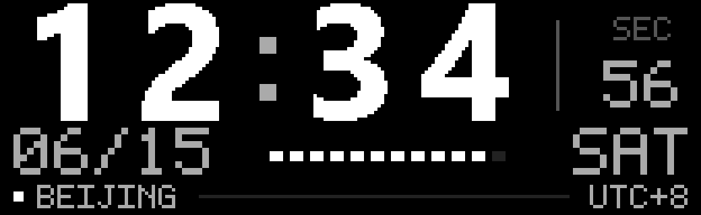

# 北京时间时钟

> 更新方式沿用此前已由用户确认没有滚动或闪黑的实时位图加重绘流程。本次只调整布局并将城市改为 BEIJING，保留秒数；新版预览与像素检查已通过，后台会持续更新。

时钟固定显示北京时间（UTC+8），与电脑当前选择的时区无关。24 小时制时间、日期和星期都来自同一个北京时间值，跨午夜会一起更新。



这是 208×64 画面按设备像素格式解码后的放大预览，不是实物照片。预览使用固定的虚构示例时间，键盘运行时会显示实际北京时间。可在仓库根目录运行 `python tools/generate_doc_previews.py` 重新生成预览。

## 布局

- 顶部：大号时、分。数字使用固定宽度的位置，更换数字时不会左右跳动。
- 右侧：秒数，与主时间之间有细分隔线。
- 中下部：月／日、英文星期，以及每 5 秒点亮一格的分钟刻度。
- 底部：`BEIJING` 和 `UTC+8`，用小号点阵字标识城市与时区。

时间、秒数、日期和分钟刻度相对原布局整体上移 11 像素。字号和实时位图更新流程保持不变。

主时间使用亮白，辅助信息使用较低亮度。默认硬边文字沿用已修正的像素顺序。`--style soft` 仍可用于比较数字边缘的抗锯齿风格。

## 启动和停止

在项目根目录双击 `启动北京时钟.vbs`。启动入口全程在后台运行，不弹出终端窗口。它会建立并启用 Windows 计划任务 `AzothX-BeijingClock`，立即运行，并在当前用户下次登录 Windows 时自动启动。默认目标刷新间隔为 1 秒，保留秒数。实际间隔受 USB 上传耗时影响。

双击 `停止北京时钟.vbs` 停止后台更新，同时禁用登录启动。再次双击启动入口会重新启用。停止后，键盘可能保留最后一帧，也可能切回保存的静态画面；静态画面的时间不会自行走动。旧的命令行入口已移到 `tools/clock_start.cmd` 和 `tools/clock_stop.cmd`，日常双击使用根目录的 `.vbs` 入口即可。

这两个入口通过无窗口控制程序调用 `tools/clock_control.ps1` 安装和管理计划任务。任务直接使用 `pythonw.exe` 运行 `tools/clock_service.py`，时钟子进程也使用 `pythonw.exe`，不再让常驻 PowerShell 创建终端。Windows 独立运行后台管理进程，不依赖启动终端或 Codex 的存活。时钟进程退出后，后台管理进程等待 3 秒再启动；管理进程自身失败时，计划任务每隔 1 分钟最多重试 3 次。另外，任务每分钟触发一次恢复检查，任务已经运行时忽略该次触发，防止管理进程退出后长期无人接管。任务没有运行时长限制，使用电池时仍可运行，不主动唤醒电脑。停止入口会同时禁用登录启动和定时恢复。

重复启动会复用已有任务；管理进程还持有文件锁，防止同时运行两个后台实例。停止前会检查保存的进程编号和命令行，避免终止其他 Python 程序。任务仅使用当前用户的普通权限，不保存密码。

以下命令均从仓库根目录执行。需要在前台调试时，先双击停止入口，再运行以下命令；按 `Ctrl+C` 停止：

```powershell
python tools/show.py clock
```

只显示一次或只保存预览：

```powershell
python tools/show.py clock --once
python tools/show.py clock --preview
```

查看后台状态：

```powershell
powershell.exe -NoProfile -ExecutionPolicy Bypass -File tools\clock_control.ps1 -Action status
```

后台运行日志保存在 `.runtime/beijing-clock.log` 和 `.runtime/beijing-clock-error.log`。逐包日志默认隐藏，记录启动、等待链路、恢复状态，并每分钟记录一次成功上传次数。每次重新启动时，上一轮日志保存为同名的 `.previous` 文件。管理进程的启动和退出记录保存在 `.runtime/clock-supervisor.log`，该文件使用 UTC 时间。无窗口启动、停止命令的输出保存在 `.runtime/clock-control.log`。

手动切换到其他显示页面前，先停止后台时钟，否则时钟会再次覆盖画面。

## 旧布局再次出现的处理

2026-10-23 排查时，北京布局的源文件没有改变，但原来的后台进程已经消失，PID 文件仍保留旧编号。Windows 没有在此期间重启。用户看到的是顶部带 `TAIPEI` 的旧画面，符合实时更新停止后，设备恢复之前保存画面的情况。旧日志没有退出原因，不能据此确认是谁结束了进程。

此次修复将后台交给 Windows 计划任务，并加入上述退出重启和登录启动。实际结束一次 Python 时钟进程后，约 3 秒成功产生新进程；重复启动没有产生额外时钟；停止入口能禁用任务并保持停止。证据保存在本机 `evidence/clock-recovery/`。

同时使用一次完整动画上传，把保存的旧台北画面替换为北京布局快照，226 个数据包及显示命令均收到确认。随后的每秒更新仍使用已验证的实时位图通道，不重复写入动画。这个备用画面是静态快照；电脑关闭、用户未登录或后台停止时，不能提供持续走动的自定义秒数。

## 时间与连接处理

当前北京时间使用 Python 自带的固定 UTC+8 时区，不依赖 Windows 是否装有 IANA 时区数据库，也不修改系统时区。这是当前时钟的规则，不用于查询北京历史夏令时。

后台运行时，连接失败或上传失败会关闭旧连接，隔 3 秒重新查找设备、读取配对信息，再从完整帧的起点重试。开机时接收器尚未就绪，程序会等待；拔插接收器后，也会重新查找当前设备路径。每个数据包只接受相同序号的 ACK，忽略迟到的旧包回显。传到一半失败时，不从中间续传。设备睡眠或不在 2.4G 模式时，仍需要按键唤醒或切换连接模式。上传不会可靠地代替物理按键唤醒屏幕。

自动设备识别针对本机已验证的 Azoth X。USB 有线接口是 `0B05:1C24 / FF00`，报告 ID 为 0，每包 60 字节；接收器是 `0B05:1ACE`，配对型号为 `1C25`，每包 59 字节。两者同时存在时，依次检查位图模式命令是否收到确认，再使用能响应的接口。USB 输入报告不含报告 ID，接收层会补齐索引。其他键盘型号和蓝牙传输需要单独验证；没有配对回复不代表存在有线键盘。

### 开机后 2.4G 连接无画面的修复

2026-10-24 日志显示，开机时程序没有读到配对表，随后输出 `no pairing table (direct keyboard?): assuming rid=2, chunk=60`，并持续出现 `WriteFile: (0x00000001) 函数不正确`。当时 Windows 能识别接收器，也存在笔记本内置的 ASUS N-KEY 接口。旧逻辑会猜测有线模式，并允许任意 ASUS 厂商接口作为候选；失败后仍在同一连接上重试。

此次修复删除了时钟入口的猜测连接方式，并在失败后重新识别设备。后台随后报告 `OMNI 2.4G: ctrl rid=2, chunk=59`，完成实时位图上传。用户确认：“已恢复，秒数正常”。像素格式、北京布局和每秒使用的实时位图重绘流程保持不变。另为后台任务加入每分钟恢复检查，避免仅有时钟子进程而没有管理进程的状态持续存在。日志和检查证据保存在本机 `evidence/receiver-reconnect/`。

实际结束管理进程后，Windows 在 57.5 秒内重新启动了管理进程，并将原时钟子进程替换为新进程；恢复后确认只有一个受管理的时钟进程。新进程再次识别出 2.4G 接收器并完成上传。这验证了管理进程意外退出的恢复；没有通过拔插真实接收器进行测试，拔插场景目前由模拟测试覆盖。

### 自动运行时弹出终端的修复

旧计划任务直接启动 PowerShell。在本机，即使设置了 `-WindowStyle Hidden`，仍会创建 Windows Terminal 窗口。2026-10-24 改为计划任务直接运行 `pythonw.exe tools/clock_service.py`；管理进程和时钟子进程都使用无窗口的 Python 程序。子进程显式重定向日志，并使用 `CREATE_NO_WINDOW`。启动、停止时所需的短时 PowerShell 命令也使用同一创建标志。

根目录的 `.vbs` 入口通过图形脚本宿主调用无窗口程序。普通 `.cmd` 入口移动到 `tools/`，保留用于命令行调试。系统的默认终端设置没有改变。

实际检查了无弹窗停止、启动、时钟子进程退出后恢复、管理进程退出后恢复。恢复完成后只有一个时钟进程，两级进程均为 `pythonw.exe`，没有关联的控制台宿主，也没有新增 Windows Terminal 进程；窗口列表没有终端窗口。后台随后重新通过 2.4G 接收器完成上传。证据保存在本机 `evidence/windowless-clock/`。登录时使用相同的计划任务入口，但没有为本次检查重启电脑。

旧的 `0x61` 动画整包上传每次都会打断显示；放慢频率只能减少次数。默认时钟已换用 `0x67/0` 设置位图、`0x67/1` 上传单帧、`0x67/2` 触发重绘。最后一步发送全零数据，不需要播放或采集音频。缺少这一步时，即使位图数据全部 ACK，屏幕也可能保持旧画面。完整排查见 [黑屏修复记录](BLACK_SCREEN_FIX.md)。

模式命令和数据包没有 ACK 时，会明确报告上传失败。ACK 是设备返回的接收确认。重绘触发命令沿用原厂只写、不等 ACK 的方式；后台日志记录完整位图上传和触发命令已发送，最终是否无闪黑仍以实物观察为准。

## 检查

```powershell
python -m unittest discover -s tests -v
```

当前自动检查全部通过，覆盖像素格式、实时位图与重绘数据包、旧动画双帧封装、北京时区、UTC 跨年换日、失败后的整帧重试、迟到 ACK 过滤、失败时不触发重绘，以及开机设备未就绪、断线后的连接重建、错误设备过滤、配对查询资源释放、后台单实例锁和旧 PID 误识别保护。连接中断场景采用模拟设备测试，实物恢复显示另由用户确认。

已检查 `00:00`、`11:11`、`23:59` 的布局预览，并确认按设备格式解码后的画面与量化目标图像一致。用户已确认实时更新时没有滚动和闪黑，后台也经过连续上传检查。键盘自身的休眠策略仍保留，正常休眠时需按键唤醒。

后台 PID 和日志文件已从早期的 `taipei-clock.*` 改名为 `beijing-clock.*`。状态查询和停止入口仍会识别旧的 `taipei-clock.pid`，改名前已经启动的后台可以正常查询和停止；后台重启后只写新文件名。`.runtime/` 里残留的 `taipei-clock*.log` 是改名前的旧日志，可以直接删除。
