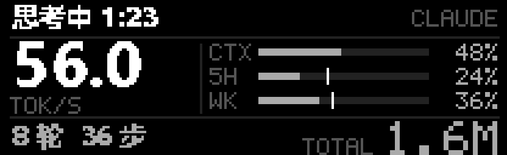

# Claude Code 状态小屏

小屏显示 Claude Code 终端状态栏里的主要内容：本轮状态、最新速度、上下文、5 小时和本周额度、轮数、步数和累计 tokens。版式与 Codex 统计页一致，沿用不滚动的实时位图更新。



这是按设备像素格式解码后的放大预览，全部数值是虚构示例。可在仓库根目录运行 `python tools/generate_doc_previews.py` 重新生成。

## 切换

- 拨杆下拨：在 Codex 和 Claude 两页之间轮流切换；从时钟下拨时回到上次看的那一页。详见 [拨杆切换说明](ROCKER_SWITCH.md)。
- 双击根目录 `启动Claude统计.vbs`：直接切到 Claude 页并启用后台。

## 屏幕内容

| 位置 | 内容 |
|---|---|
| 顶行 | `思考中 1:05`、`运行 Bash 2:14`、`已完成 14:32`、`已中断`、`已停止`（超过 20 分钟没有新记录）或 `新会话` |
| 顶行反色 | `等待确认 0:42`（权限确认）或 `等待回答`（AskUserQuestion），提醒回终端处理 |
| 右上角 | `CLAUDE`；同时开着多个会话时显示 `CLAUDE X2` |
| 中左 | 最新一次请求的输出速度 `TOK/S` |
| 中右 | `CTX` 上下文（按自动压缩窗口计算，和终端一致）、`5H` 5 小时额度、`WK` 本周额度；亮竖线表示时间窗口已过去的比例，用量达到 80% 时进度条变亮 |
| 底行 | 轮数、步数、累计 tokens |

多个会话同时运行时，小屏跟随**你最后发过消息、或最后打开的那个会话**：在哪个会话里发出消息，下一秒就切过去；新打开或恢复（`--resume`）的会话也立即显示。唯一的例外是等待确认：任何会话在等你批准或回答时都优先显示，处理完后回到你所在的会话。只切换终端标签而不发消息时，小屏不会跟着变，因为终端不向其他程序报告当前激活的标签。额度属于整个账号，取所有会话里最新的一份。

### Claude 未启动

没有会话在运行时显示 `Claude 未启动`。顶行是上次会话的结束时间、轮数和 tokens，底行保留最后记录的额度和重置时间，例如 `5H 23% 17:15`、`WK 41% WED 19:39`。已过重置时间的额度显示 `--`，不沿用旧百分比。

## 数据来源与联网

Claude Code 的状态栏命令接入 `tools/claude_status.py statusline`。它先运行原来的 `~/.claude/statusline.py`，再调用其中的统计函数，把精简快照写到 `.runtime/claude/<会话ID>.json`。快照包含会话标识、模型名、时间、数字、状态和工具名，不含提示词和回复正文。

状态栏设置了每秒刷新，快照随之每秒更新，相当于心跳。显示后台在 5 秒内看到快照内容变化，就认为该会话在运行。判断使用 Windows 本机时钟观察到的“内容是否变化”，不比较 WSL 和 Windows 的时间，避免睡眠后时钟漂移造成误判。

**Claude 显示后台只读本机文件。** 它不启动、不查询、也不连接 Claude；Claude 未打开时显示最后一份快照。适配器自身没有网络请求代码，但会执行用户提供的原状态栏，不能保证任意第三方状态栏都不联网。当前适配的额度来自 Claude Code 正常使用时的响应。

“等待确认/回答”由两个钩子标记：`Notification`（`permission_prompt`）和 `PreToolUse`（`AskUserQuestion`）运行 `claude_status.py waiting permission|question`。会话记录出现新进展（工具结果、完成或中断）后，标记自动清除。

## 接入条件与配置

当前适配的是 **WSL 中的自定义 Python 状态栏**，不是任意 Claude Code 状态栏的通用读取器。原始 `~/.claude/statusline.py` 和个人 `settings.json` 均不随仓库分发。Windows 原生 Claude Code 尚未验证。

原状态栏需要提供这些函数，完整字段对应关系见 [`tools/claude_status.py`](../tools/claude_status.py)：

| 函数 | 用途 |
|---|---|
| `main()` | 从标准输入读取状态栏 JSON，并输出原终端状态栏 |
| `cached_summary(transcript_path)` | 返回轮数、步数、速度、tokens、状态及时间等摘要 |
| `remembered_limits(rate_limits)` | 返回 `five_hour` / `seven_day` 用量及重置时间 |
| `compact_window(model_id)` | 返回模型自动压缩上下文的窗口大小 |

缺少这些接口时，不能保证完整统计和原终端状态栏正常显示，需要先适配自己的脚本。可以通过环境变量 `OLED_CLAUDE_STATUSLINE` 指定兼容脚本的位置。

接入步骤：

1. 备份自己的 `~/.claude/settings.json`，记录原状态栏命令。
2. 将状态栏命令接到 `python3 /path/to/AzothX-OLED/tools/claude_status.py statusline`。把 `/path/to/AzothX-OLED` 替换为 WSL 可访问的实际仓库路径；Windows 显示后台必须读取同一份仓库中的 `.runtime/`。
3. 确保状态栏约每秒刷新。显示后台在快照持续 5 秒没有变化时会判为离线，因此仅在新消息到达时刷新的配置不适用。
4. 如需等待提醒，在现有 `Notification` 的 `permission_prompt` 钩子中追加 `python3 /path/to/AzothX-OLED/tools/claude_status.py waiting permission`，在 `PreToolUse` 的 `AskUserQuestion` 钩子中追加 `python3 /path/to/AzothX-OLED/tools/claude_status.py waiting question`。保留原有钩子。
5. 启动 Claude Code 并确认原终端状态栏正常，再双击 `启动Claude统计.vbs` 查看小屏。

可以在状态栏命令中加入脚本不存在时回退原命令的判断。撤销接入时恢复自己的设置备份。快照保存在 `.runtime/claude/`，不进 Git，超过 7 天的会话文件会在后续导出时清理。

## 可选：等待时自动跳转

默认关闭。创建 `.runtime/display-options.json`：

```json
{"claude_waiting_autojump": true}
```

开启后，任一 Claude 会话等待确认时，小屏临时显示 Claude 页；处理完后回到原来选择的页面。所选页面本身不会被改写。

## 验证

- 同一份输入交给原状态栏和包装脚本，终端输出逐字节相同；一次运行约 0.25 秒。
- 在当前会话中确认快照每秒更新；两个会话同时运行时显示 `X2`，并跟随最后发消息或打开的会话。
- 时钟、Claude、Codex 三页实际上传均收到确认，错误日志为空。
- 自动检查覆盖快照字段、上下文换算、不安全会话 ID、超时转为已停止、等待标记的设置与清除、发消息和重新打开时的焦点切换、按内容变化判断在线、时钟漂移、会话优先级、额度取最新、各状态渲染和拨杆轮换。
- 尚未实测：等待确认时的反色提示（需要一次真实的权限确认）、关闭 Claude Code 后约 5 秒切到“未启动”、拨杆实物切换。
