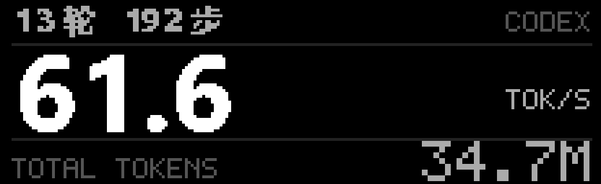

# Codex 实时统计小屏

小屏显示当前 Codex 对话的轮数、步数、最新速度和累计 tokens。布局针对 208×64 像素设计，沿用已修正的 4bpp 像素顺序和不滚动的实时位图更新。

这是按设备像素格式解码后的放大预览。预览数值来自制作时的真实统计快照，运行时会继续变化。

## 使用

- 双击根目录 `启动Codex统计.vbs`：切换到 Codex 统计并启用后台。
- 双击 `启动北京时钟.vbs`：切回原来的北京时钟。
- 双击 `停止北京时钟.vbs`：停止整个显示后台，并禁用登录启动和定时恢复。

三个入口都在后台运行。所选页面保存在本机 `.runtime/display-mode.json`；登录后恢复所选页面。页面共用一个屏幕上传进程。

顶部显示轮数、步数；中间大号数字是 `TOK/S`；底部是 `TOTAL TOKENS`。K、M、B 分别表示千、百万、十亿。单项缺失时显示 `--`。

拿不到统计时，屏上直接写明原因：`Codex 未启动`、`无活动对话`、`多个对话窗口`、`统计插件未启用`、`统计未连接`、`统计暂停更新`或`读取中`。顶行显示上次统计的时间，底行保留上次的轮数、步数和累计 tokens（保存在 `.runtime/codex-last.json`）。是否启动只检查本机进程列表里的 Codex 应用，Codex 关闭时不会启动它，也不会联网查询。

下拨拨杆可在本页和 [Claude 状态小屏](CLAUDE_STATS.md) 之间切换。

## 数据来源与刷新

复用已安装的 `Codex 输入栏统计` 插件 3.1.1 的本地统计读取器。先通过插件的状态读取函数确认活动对话，再使用其 `UsageWorker.query` 读取该对话的统计。桥接代码位于本项目 `tools/codex_stats.py`。

| 屏幕字段 | 插件数据字段 |
|---|---|
| 轮数 | `rounds` |
| 步数 | `steps` |
| TOK/S | `generation.latest` |
| TOTAL TOKENS | `usage.total_tokens` |

速度表示插件最近已记录的输出速率，数值何时更新由插件采样决定。当前来源 `sub2api-request` 使用完整请求时长，包含首字前等待；插件采用客户端估算时，也沿用其估算值。界面刷新不重新计算速度或累计用量。

本地统计每约 2 秒读取一次，屏幕目标每秒刷新。插件原有的远程查询间隔、失败退避和空闲查询预算仍由其统计读取器管理。显示端只保留上表四项数值、必要的会话标识和来源说明，不向小屏传递聊天内容。

`local:<UUID>` 会规范化为同一对话 ID。新建空白对话、插件停用、没有可识别的活动对话，或同时存在多个不同的活动窗口时，显示对应的原因。超过 10 秒未更新的快照显示`统计暂停更新`，不会继续冒充新数据。

## 依赖和兼容范围

本功能依赖已安装的统计插件及其 Node 环境。本机桥接配置保存在 `.runtime/codex-stats-source.json`，仅记录插件目录和 Node 路径。Python 端需要 `websocket-client`。

读取器接口按已验证的插件 3.1.1 版本绑定。插件升级后若版本不符，屏幕显示缺失值，日志会说明需要更新桥接；不会自行猜测新版字段。本次没有改动统计插件或 Codex 的安装文件、界面注入和设置。

## 排查和验证

- `.runtime/codex-stats.json`：最新的精简统计快照。
- `.runtime/beijing-clock.log`：连接、上传及当前页面；统计页面记录 `[display] codex`。
- `.runtime/beijing-clock-error.log`：后台异常。
- `evidence/codex-stats/`：本机快照、预览和检查记录。

数据读取与屏幕上传分开运行，统计来源暂时不可用时，屏幕上传仍能继续。Windows 任务、无窗口启动、连接恢复与原时钟共用。

检查覆盖字段对应关系、未知值处理、对话身份校验、多个活动窗口、过期快照、切回时钟及旧进程编号误用保护。测试命令为 `python -m unittest discover -s tests -v`。预览经过 4bpp 编码解码检查，像素差异为零；实物显示仍需结合键盘上的观察。

2026-10-25（America/Chicago）完成接入后，34 项自动检查通过。后台记录了统计页面上传，并读取到连续变化的步数、速度和累计 tokens；切回时钟时保持同一个显示进程。用户实物确认：“显示正常，清楚且会更新”。
