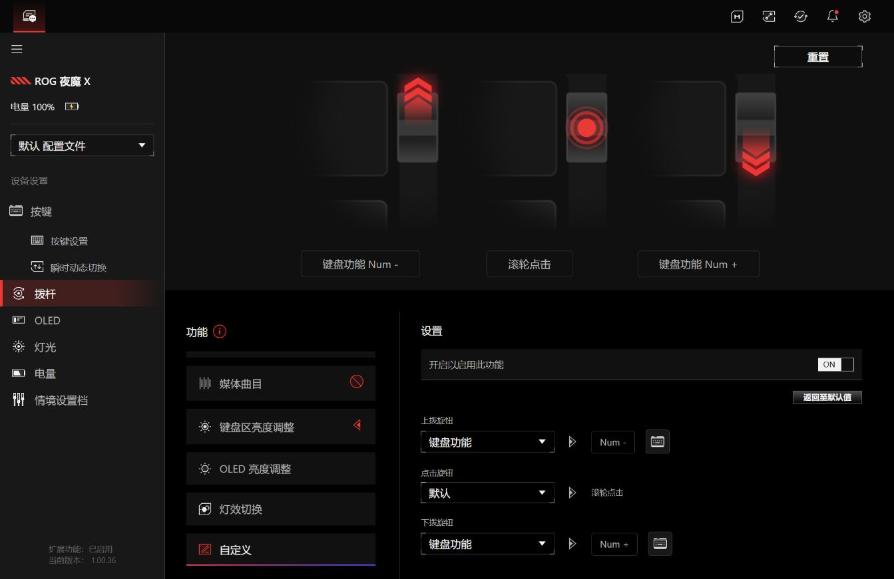

# 拨杆切换时钟、Codex 与 Claude

完成下方配置后，拨杆处于“自定义”功能时：

| 操作 | 小屏显示 | Gear Link 内的绑定 |
|---|---|---|
| 上拨 | 北京时间 | 键盘功能 → Num -（数字小键盘减号） |
| 下拨 | Codex 与 Claude 轮流 | 键盘功能 → Num +（数字小键盘加号） |

正常运行时，页面会在下一次屏幕刷新时切换，通常约 1 秒。首次恢复设备连接可能需要更久。2026-10-25，用户在有线连接下确认“两个方向都正常”。



## 日常使用

1. 将拨杆的功能模式切到“自定义”。
2. 上拨看时钟；下拨在 Codex 和 Claude 之间轮流切换。从时钟下拨时，回到上次看的那一页。

Codex 或 Claude 没有打开时也能切过去，屏上会显示 `Codex 未启动` 或 `Claude 未启动`。离线页面展示本地缓存，不会主动启动对应应用。Codex 运行时使用的插件读取器可能查询远程用量元数据，详见 [Codex 数据来源](CODEX_STATS.md)；Claude 显示端只读本地快照，详见 [Claude 状态小屏](CLAUDE_STATS.md)。

后台随现有 Windows 任务自动运行，不需要一直打开设置网页，也不会弹出终端。原来的 `启动北京时钟.vbs`、`启动Codex统计.vbs` 和 `启动Claude统计.vbs` 仍可切换页面。停止整个后台后，拨杆对应的这两个全局快捷键也会释放。

这两个信号使用独立的数字小键盘加减键，普通数字行的 `+ / -` 仍可正常输入。如果另接带数字小键盘的键盘，其数字小键盘加减键也会触发页面切换。

实际设置入口是 [Gear Link](https://gearlink.asus.com/)，[华硕 FAQ](https://www.asus.com/support/faq/1054795/) 是帮助说明页。截图中的网页扩展版本为 1.00.36。

## 首次配置

1. 在 Gear Link 连接自己的键盘，打开“拨杆 → 自定义”，启用该功能。
2. 上拨选择“键盘功能 → Num -”，下拨选择“键盘功能 → Num +”，保存设置。
3. 在仓库根目录的 PowerShell 中执行以下命令，创建本地监听配置：

```powershell
New-Item -ItemType Directory -Path .runtime -Force | Out-Null
'{"enabled": true}' | Set-Content -LiteralPath .runtime/rocker-config.json -Encoding ascii
```

4. 如果显示后台已运行，先双击 `停止北京时钟.vbs`，再双击 `启动北京时钟.vbs`。监听配置在后台启动时读取。
5. 将键盘拨杆的功能模式切到“自定义”，上拨、下拨验证切换。Codex 和 Claude 的数据源需要分别配置。

`.runtime/rocker-config.json` 不随仓库分发，因此新克隆的仓库不会自动启用拨杆监听。停用时将 `enabled` 改为 `false`，再重启显示后台。

## 工作方式

`tools/rocker_switch.py` 使用 Windows `RegisterHotKey` 注册 `VK_SUBTRACT (0x6D)` 和 `VK_ADD (0x6B)`。收到信号后，直接写入 `.runtime/display-mode.json`，其中 `last_ai` 记录上次看的 AI 页面；正在运行的屏幕程序读取同一个模式文件，无需重启或另外打开显示程序。长按不重复触发。

监听器由 `tools/clock_service.py` 管理，与时钟、统计共用无窗口后台。启用配置位于 `.runtime/rocker-config.json`，内容包含 `{"enabled": true}`。运行状态位于 `.runtime/rocker-status.json`，拨动记录写入 `.runtime/clock-supervisor.log`。

## 有线和接收器同时连接

有线夜魔 X 的设备 ID 为 `0B05:1C24`，控制接口为 `FF00`，输出报告 ID 为 0，每包 60 字节。它的输入报告不包含报告 ID；接收层会补齐索引后再匹配确认包。

OMNI 接收器为 `0B05:1ACE`，配对表中的夜魔 X 型号为 `1C25`。经接收器传输时沿用报告 ID 2、每包 59 字节。

电脑同时插着 USB 线和接收器时，程序会检查实际能响应位图模式命令的接口。切换连接方式导致原连接失败时，重新识别后再完整上传，避免一直向未活动的接收器重试。此次有线切换已实测；2.4G 传输此前已验证，蓝牙 OLED 上传尚未验证。

## 验证记录

- Gear Link 页面保存并显示上拨 `Num -`、下拨 `Num +`。
- Windows 实际快捷键注册、消息队列处理、时钟/统计切换及退出释放检查通过。
- 38 项自动检查通过，包含 USB 与接收器同时存在、接口失败后回退，以及两种报告格式的确认包解析。
- 用户实际拨动后，日志记录了两个方向的信号；有线接口完成了时钟和统计页面上传。
- 用户确认“两个方向都正常”。

本机证据保存在 `evidence/rocker-switch/`。
